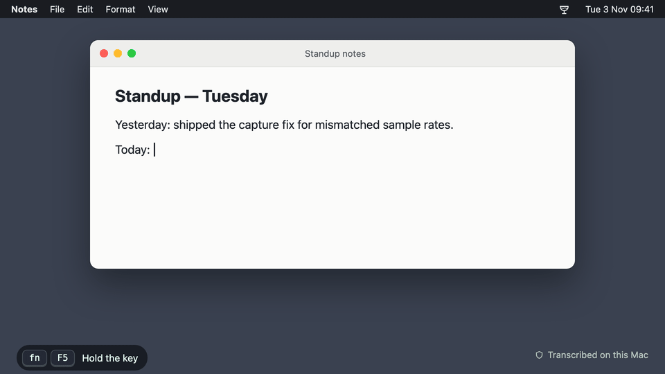

# Speakeasy — On-Device Push-to-Talk Dictation



A compact macOS menu-bar utility providing **hold-to-speak dictation that is
processed completely on your machine**. Press and hold a system-wide shortcut,
talk, let go — and what you said is typed directly into whichever application
currently has focus (terminal, editor, messenger, anything at all).

There's no window and no Dock icon; the utility lives entirely in the menu bar.

## Features

**Dictation**
- **Push-to-talk anywhere** — hold the talk key (default **F5**, so `fn` + `F5`
  on a MacBook), speak, let go. Any key, key combination or a lone modifier
  such as Control can be the talk key.
- **Hold or toggle** — hold while speaking, or tap once to start and again to
  finish for long dictation.
- **Types into any app** — the text lands at the cursor as simulated
  keystrokes, without touching the clipboard. Optional paste mode for speed.
- **Escape discards** (optional) — throw away a dictation instead of typing it.
- **Many languages** — every language Apple's on-device recogniser offers;
  macOS fetches a language's model the first time you pick it.

**Seeing what's happening**
- **Live overlay** — a capsule at the bottom of the screen shows up to two
  lines of transcript as you speak (still-changing words in grey), a timer,
  and a ✓ once the text has been typed. It never steals focus.
- **The glass fills with your voice** — the coupe in the overlay and the
  menu bar rises and sloshes with your input level, so a dead mic is obvious.
- **Animated menu-bar icon** — idle, listening, finishing and needs-setup
  states; a template image that fits light, dark and tinted menu bars.
- **No-audio warning** — if the microphone delivers nothing, the overlay
  turns amber and says so while you're still holding the key.

**Accuracy**
- **Personal vocabulary** — names and jargon handed to the recogniser before
  you speak, so they come out spelled your way.
- **Find & replace rules** — exact-match swaps on the finished text
  (“eye phone” → “iPhone”), each with its own on/off and case switch.

**Setup and comfort**
- **Microphone picker** — including multi-channel audio interfaces; a
  pre-dictation check handles input and output devices that run at different
  sample rates.
- **Guided first run** — a three-step checklist for Microphone, Speech
  Recognition and Accessibility, with the right button for each step.
- **Recent transcripts** (optional) — the last 10, in memory only, to copy
  again; gone when you quit.
- **Hover help** — every preference has an ⓘ explaining what it does.
- **Start at login** (optional).

**Private by design**
- Speech recognition runs **on this Mac** (Apple `SpeechAnalyzer`); the app
  contains no networking code. Details below.

## Download

Get the latest **Speakeasy-x.y.z.zip** from
[Releases](https://github.com/uxpresso-martinis/speakeasy/releases/latest)
(macOS 26 or newer, Apple silicon). Unzip it and move **Speakeasy.app** into
**Applications**.

The app isn't notarised by Apple, so macOS blocks the first launch. Go to
**System Settings › Privacy & Security**, scroll down and click **Open Anyway**
(or run `xattr -dr com.apple.quarantine /Applications/Speakeasy.app`). Then
follow the checklist in the menu-bar panel to grant the three permissions.

**Updating.** Quit Speakeasy, replace the app in Applications, open the new
one. Every release has a new signature, so macOS treats it as a different app:
the Accessibility switch may still look on but belong to the old build, and
the talk key then does nothing. Remove Speakeasy from **System Settings ›
Privacy & Security › Accessibility** with **−** and add it again from the
panel's checklist, or run:

```sh
tccutil reset Accessibility com.mschade.localstt
```

## Motivation

The built-in system dictation is serviceable, but this offers a compact,
modifiable, completely local substitute: a single shortcut, on-device speech
recognition, and output that lands at the insertion point.

## Transparency notice

This project is mostly coded by AI. For someone like me, AI is a great help to
finally get ideas done and out of their eternal alpha state. I know other people
might see it differently, and that's why I want to be transparent about it.

## Privacy & what "local" means here

- **Completely on-device.** Conversion relies on Apple's local
  `SpeechAnalyzer` / `SpeechTranscriber` (macOS 26). Audio is handled on your
  machine and **never travels beyond it** — the utility ships without any
  networking code at all.
- **Confidential.** Nothing gets transmitted, reported to a server, or logged
  remotely. The finished text is typed at the insertion point, and the app
  itself keeps no copy of it.
- **One honest caveat:** the first time a language model is used, macOS itself
  may fetch that model from Apple as a system asset (the same route the OS uses
  for its own dictation). The operating system performs that *model* download —
  your **voice and transcripts go nowhere**.

A pair of optional settings alters what is exposed on the machine, so each is
**disabled out of the box**:

- **Paste rather than type.** Considerably quicker for lengthy dictation,
  though the transcript briefly occupies the general clipboard, readable by any
  process running under your account. The earlier clipboard contents are put
  back afterwards, and the entry is flagged as concealed so well-mannered
  clipboard tools ignore it.
- **Recent transcripts.** Retained **in memory exclusively** — never persisted
  to disk and gone the moment you quit. There is intentionally no way to make
  them permanent.

Your word list and substitution rules *do* live on disk, inside
`~/Library/Application Support/com.mschade.localstt/vocabulary.json`, written
owner-only (`0600`) and never synchronized anywhere.

## Under the hood

- **SwiftUI `MenuBarExtra`** — the entire interface is a menu-bar agent
  (`LSUIElement`, hence no Dock icon).
- **Speech** — `SpeechAnalyzer` together with `SpeechTranscriber`, using the
  `.progressiveTranscription` preset to stream partial results.
- **AVFoundation** — an `AVAudioEngine` grabs the microphone while an
  `AVAudioConverter` reshapes buffers into the format the analyzer expects.
- **CoreAudio** — feeds the selected input device into the audio engine
  (`kAudioHardwarePropertyTranslateUIDToDevice` plus
  `kAudioOutputUnitProperty_CurrentDevice`).
- **System-wide shortcut** — an active `CGEventTap` listens for the talk key
  across the whole OS and *consumes* it (which is why holding it down doesn't
  type the key).
- **Live overlay (HUD)** — a translucent, focus-preserving, click-through
  floating panel mirrors the transcript **while you talk**, then fades away
  when you release. It never takes focus from the app receiving the dictation.
  It is a capsule showing up to two lines of transcript (still-changing words
  in grey) and a timer. Its coupe badge doubles as the input meter: the glass
  fills with your voice, so a dead mic is obvious.
- **Menu-bar icon** — the coupe from the app icon, drawn as a template image.
  While you dictate it animates (liquid follows your voice, bubbles rise);
  a dot marks missing permissions.
- **Look** — "Mint on Ink", the app icon's palette (`Theme.swift`).
- **Auto-typing** — when you release, the finished text is delivered at the
  insertion point through synthesized Unicode `CGEvent` keystrokes, which works
  in any application and **never involves the clipboard**.

Source layout (`Sources/LocalSTT/`):

| File | Responsibility |
|------|----------------|
| `App.swift` | Menu-bar app & `AppDelegate` startup sequence |
| `AppModel.swift` | Coordinator connecting shortcut → capture → transform → output |
| `Settings.swift` | All optional behaviour, stored in `UserDefaults` |
| `MenuPanel.swift` | The dropdown panel, including the permissions checklist |
| `Theme.swift` | Palette and shared controls (cards, rows with hover help, buttons) |
| `CoupeGlyph.swift` | The coupe glyph: one geometry for menu bar, panel and overlay |
| `HotkeyRecorder.swift` | Captures the talk shortcut, modifiers included |
| `SettingsView.swift` | Preferences screen |
| `VocabularyEditor.swift` | Editor for words and substitution rules |
| `HUDController.swift` | Floating live-transcript capsule and its states |
| `SnapshotRenderer.swift` | Debug builds only: renders every screen to PNG (see Tests) |
| `TranscriberEngine.swift` | Audio + speech pipeline and its session state machine |
| `AudioDeviceManager.swift` | Input-device discovery plus persisted choice |
| `CoreAudioHelpers.swift` | Mapping device UIDs onto CoreAudio routing |
| `HotkeyManager.swift` | The system-wide `CGEventTap` for push-to-talk |
| `TextInjector.swift` | Keystroke and paste delivery |
| `Permissions.swift` | Microphone / Speech / Accessibility gates |
| `LoginItem.swift` | Login-item registration through `SMAppService` |

Pure logic sits in its own library target, allowing unit tests without a
microphone or permission prompts (`Sources/LocalSTTCore/`):

| File | Responsibility |
|------|----------------|
| `Shortcut.swift` | Shortcut model, storage, display formatting |
| `PushToTalkMatcher.swift` | Key events → press / release / swallow for the talk key |
| `AudioMixdown.swift` | Multi-channel → mono mixing and level measurement |
| `LevelSmoother.swift` | Attack/release easing applied to the level |
| `TextTransformer.swift` | Exact-match substitution rules |
| `TextChunker.swift` | Breaks text into keystroke-event-sized segments |
| `TranscriptHistory.swift` | Bounded, memory-only transcript list |
| `VocabularyStore.swift` | Vocabulary JSON with owner-only permissions |
| `DeviceSelectionPolicy.swift` | Deciding which input device to use |
| `CaptureFormatPolicy.swift` | Pre-dictation check of the mic's real format (input/output rate mismatch) |
| `CoupeAnimation.swift` | The coupe's motion: liquid level, wave, bubbles |

## Requirements

- **macOS 26 (Tahoe) or newer** on Apple silicon.
- **Xcode** or the **Xcode Command Line Tools** (Swift 6.2+). SwiftPM plus a
  small packaging script do everything; the Xcode IDE itself is never opened.
  - Command Line Tools: `xcode-select --install`
  - With Command Line Tools 27.x, the macOS 27 SDK can't build the package.
    `scripts/swiftw` (used by `build.sh` and `make`) detects this and builds
    against an installed macOS 26 SDK with the native build system instead.
    Full Xcode needs no workaround.

## Building & running

```sh
# 1. (Recommended, once) create a stable self-signed code-signing certificate
#    so macOS retains your permission approvals between rebuilds.
#    Keychain Access ▸ Certificate Assistant ▸ Create a Certificate…
#      Name: "LocalSTT Self-Signed"
#      Identity Type: Self-Signed Root
#      Certificate Type: Code Signing
export CODESIGN_IDENTITY="LocalSTT Self-Signed"   # leave unset to ad-hoc sign

# 2. Produce the app bundle.
bash build.sh        # compiles, assembles and signs Speakeasy.app

# 3. Start it.
open Speakeasy.app
```

The app icon lives in `Resources/`: `AppIcon.svg` is the source and
`AppIcon.icns` the generated file `build.sh` copies into the bundle. After
editing the SVG, run `make icon` (`scripts/make-icon.sh`) to regenerate it.

`build.sh` outputs `Speakeasy.app` at the project root. Without
`CODESIGN_IDENTITY` it signs ad-hoc — that runs fine, but since the signature
differs on each build, macOS drops your permission approvals every time you
rebuild.

Every build is signed with the **hardened runtime** and a single entitlement,
microphone input (`Speakeasy.entitlements`). The hardened runtime stops other
processes from injecting code into Speakeasy and borrowing its Microphone and
Accessibility approvals. `build.sh` fails if either is missing from the
signature.

### Releasing

Push a version tag; the Release workflow (`.github/workflows/release.yml`)
tests, builds, stamps the version into `Info.plist`, zips the app and
publishes it as a GitHub Release with install notes and a SHA-256:

```sh
git tag v1.0.1 && git push origin v1.0.1
```

Release builds are signed ad-hoc (the runner has no signing identity) and not
notarised. Notarisation, which removes the "Open Anyway" step, needs a paid
Apple Developer account.

GitHub's macOS arm64 runners are sometimes never assigned and the job fails
after a long queue. CI can be re-run by hand (`workflow_dispatch`). For a
release, cancel the stuck run before publishing a locally built zip, so a late
run can't collide with it.

## Tests

```sh
make check      # build + tests (what CI runs)
make test       # tests only
```

The test suite exercises `LocalSTTCore`, the logic requiring no hardware. The
audio, permission and event-tap layers are checked manually. `scripts/test.sh`
exists because swift-testing sits outside the default search paths when only
the Command Line Tools are present; with full Xcode, plain `swift test`
suffices.

To check the UI without clicking through it, a debug build can render every
panel screen, overlay state and menu-bar icon mode to PNGs, offscreen, using
in-memory sample data (no permission prompts, nothing saved):

```sh
swift build -c debug
.build/debug/LocalSTT --snapshot /tmp/speakeasy-snapshots
```

Controls draw in their inactive (grey) look in these images, since the
offscreen window never becomes key.

## Permissions (first run)

Until all three are granted, the panel shows a checklist with the next step
and the right button for it. macOS asks for three approvals; accept the
prompts (or visit **System Settings ▸ Privacy & Security**):

1. **Microphone** — so the app can hear you.
2. **Speech Recognition** — which powers the local transcription.
3. **Accessibility** — needed for the system-wide talk key and for typing the
   outcome at the insertion point. This approval is not a pop-up: switch on
   **Speakeasy** inside *Privacy & Security ▸ Accessibility*.

## How to use

1. Click the menu-bar icon to open the panel.
2. Choose your **microphone**.
3. Assign a **talk key** — open Preferences (gear), click **Change** next to
   *Talk key*, then press whichever key you want to hold. (On laptops the function row emits *feature* keys by default,
   so a plain `F5` might not come through; either hold `Fn` with the key, turn
   on "Use F1, F2 as standard function keys" in Keyboard settings, or choose a
   non-feature key such as **Right Control**.)
4. Click into any text field, then **hold the key, talk, and release** → a
   floating overlay mirrors the transcription while you speak, and the words
   are typed at the insertion point when you let go. The menu-bar icon
   animates during capture.

Every preference has an ⓘ: hover it (or the row) for what the setting does.

A lone modifier also works as the talk key: click **Change**, then tap and
let go of a single modifier (say, Control). Bear in mind that macOS event flags
carry no left/right information, so "Right Control" actually binds Control on
either side.

## Preferences

Everything listed here is optional; the defaults recreate the original
behaviour. Find them behind the gear in the panel.

| Setting | Default | Effect |
|---------|---------|--------|
| Shortcut style | Hold the key to speak | Alternatively tap once to begin and again to finish, handy for long dictation. |
| Escape discards | Off | Escape drops the in-progress dictation rather than typing it. Escape is intercepted only during an active dictation. |
| Deliver text by | Typing | Alternatively pasting — far quicker for long text, with the clipboard trade-off noted above. |
| Prefer my vocabulary | Off | Hands your words to the recognizer so names and jargon are transcribed correctly. |
| Apply my find-and-replace rules | Off | Exact-match (never pattern) find/replace on the finished text. |
| Remember recent transcripts | Off | The last 10, in memory only. |
| Glass follows your voice | On | The coupe in the overlay fills with the input level, making a dead mic obvious. When off, it merely animates. |
| Dictation language | en-US | Any locale `SpeechTranscriber` offers; macOS fetches the model on first use. |
| Start automatically at login | Off | Registers a login item. Bound to the app's location, so leave it in `/Applications`. |

## Troubleshooting

**The mic runs but nothing is transcribed.** Before every dictation the app
compares the mic's real sample rate with the one `AVAudioEngine` reports. They
differ when the input and output devices run at different rates (for example
mic at 48 kHz, speakers at 44.1 kHz after playing music), and a tap at the
reported rate silently receives nothing. The app taps at the hardware rate
instead. If audio still doesn't arrive, the overlay turns orange with
"No audio from the microphone" while you hold the key. Capture logs live under
subsystem `com.mschade.localstt`:

```sh
log show --last 10m --predicate 'subsystem == "com.mschade.localstt"'
```

**The talk key does nothing after an update.** See *Updating* under
[Download](#download): the Accessibility approval belongs to the old build.

**A dictation finished on its own after 10 minutes.** That's the safety cap.
If the key's release is ever lost (for example, a password field switched on
Secure Input while you held it), the microphone must not stay open
indefinitely. The text up to that point is delivered as usual.

## Additional notes

- Not sandboxed and not meant for the App Store, but signed with the hardened
  runtime (see *Building & running*).
- The default language is **en-US**; it can be changed in the preferences.

## License

Speakeasy is free software under the [GNU General Public License v3.0](LICENSE).
You may use, study, change and share it. If you distribute a modified version,
it must be under the GPL too, with its source code available.
