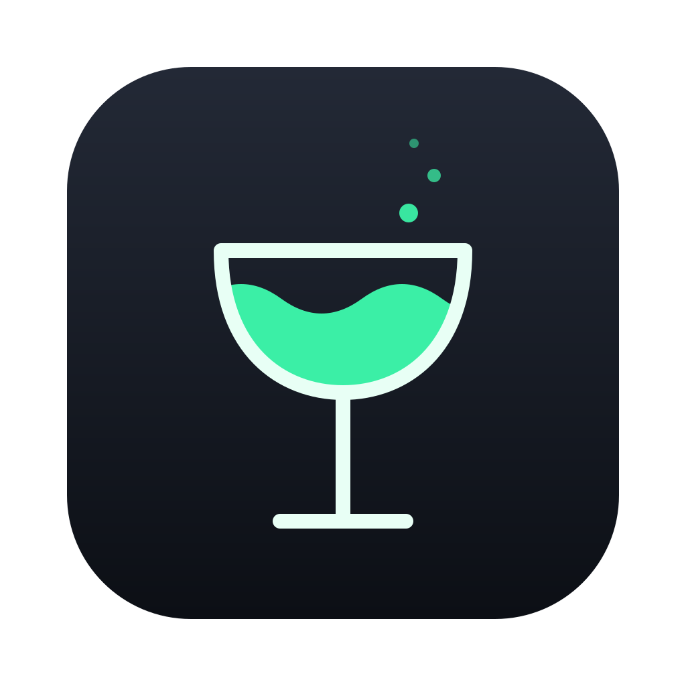
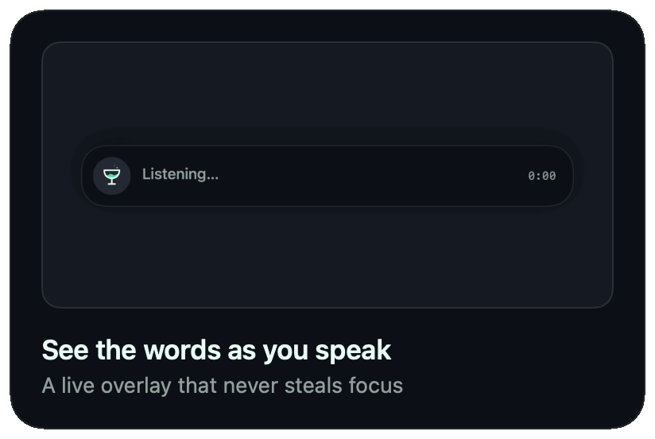
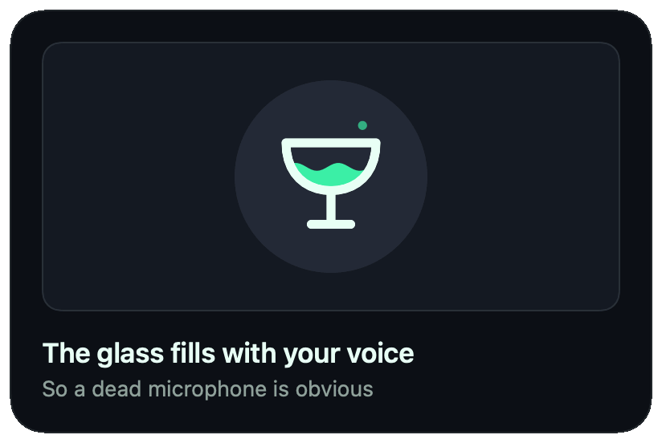
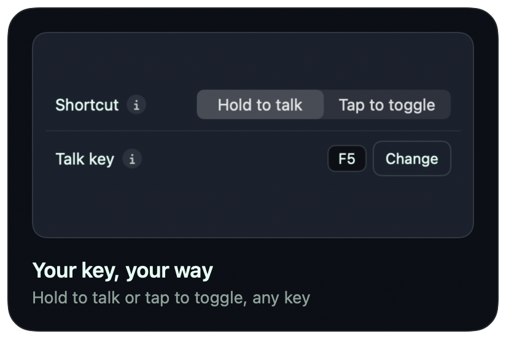
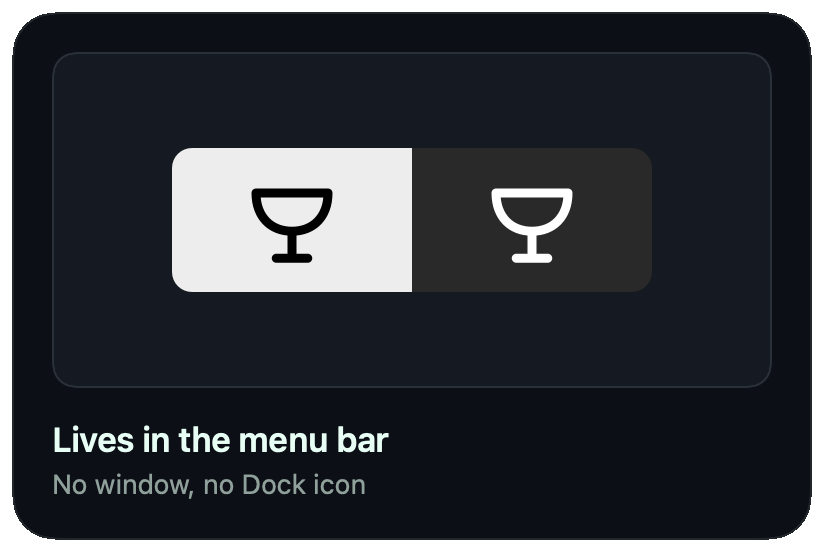
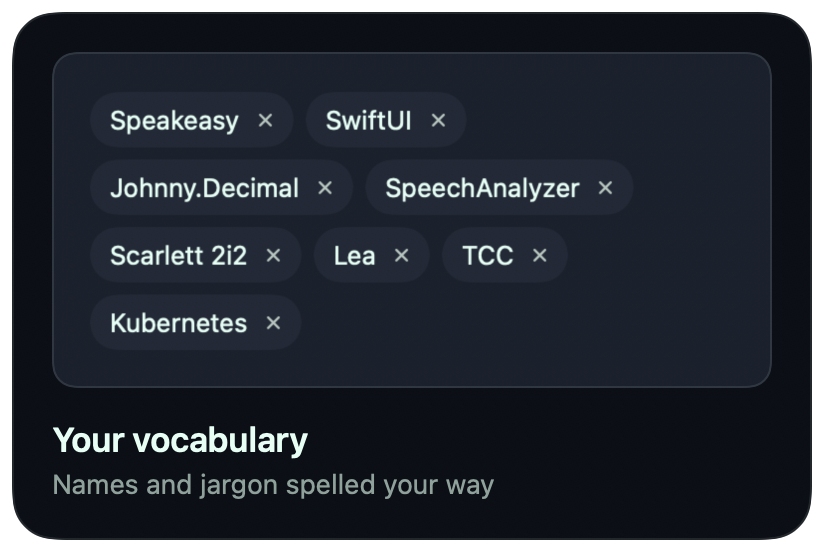
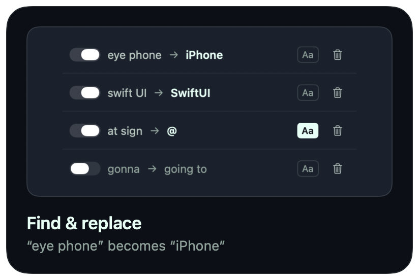

<div align="center">



# Speakeasy

**Hold a key, speak, let go. Your words are typed wherever the cursor is.**<br>
Dictation for your Mac that never leaves your Mac.

[](https://github.com/DrPity/speakeasy/releases/latest)
[](#install)
[](#privacy)
[](LICENSE)

**[⬇ Download the latest version](https://github.com/DrPity/speakeasy/releases/latest)**


</div>

> [!NOTE]
> **Transparency notice:** This project is mostly coded by AI. For someone like me, AI is a great help to finally get ideas done and out of their eternal alpha state. I know other people might see it differently, and that's why I want to be transparent about it.

## Install

1. Download **Speakeasy-x.y.z.zip** from [Releases](https://github.com/DrPity/speakeasy/releases/latest), unzip it and move **Speakeasy.app** into **Applications**.
2. Open it, then follow the checklist in the menu-bar panel to allow **Microphone**, **Speech Recognition** and **Accessibility**.

> [!IMPORTANT]
> Speakeasy isn't notarised by Apple yet, so macOS blocks the first launch. Go to **System Settings › Privacy & Security**, scroll down and click **Open Anyway**, or run:
> ```sh
> xattr -dr com.apple.quarantine /Applications/Speakeasy.app
> ```

> [!TIP]
> **Updating?** Quit Speakeasy and replace the app. If the talk key then does nothing, macOS still holds the Accessibility approval for the old build: remove Speakeasy under **Privacy & Security › Accessibility** with **−** and allow it again from the panel, or run `tccutil reset Accessibility com.mschade.localstt`.

## Use

1. Click into any text field.
2. Hold <kbd>fn</kbd> + <kbd>F5</kbd> (or just <kbd>F5</kbd>) and speak.
3. Let go. The text is typed at the cursor.

Change the talk key, switch to tap-to-toggle or pick another language behind the ⚙ in the panel. Every setting has an ⓘ that explains it.

## Features

<p align="center">
   <br>
   <br>
   
</p>

**Also:** a lone modifier such as Control as talk key · Escape to discard · every language Apple's on-device recogniser offers · any microphone, including multi-channel interfaces · a warning when the mic delivers no audio · recent transcripts kept in memory only · guided first run · start at login.

## Privacy

> [!NOTE]
> **Audio and text never leave your Mac.** Speech recognition runs on-device with Apple's `SpeechAnalyzer`, and Speakeasy contains no networking code at all.

- The first time you use a language, macOS may download its speech model from Apple, the same way system dictation does. Your voice and transcripts are never part of that.
- Text is typed as keystrokes and never touches the clipboard. The optional **paste mode** is faster but briefly puts the text on the clipboard.
- **Recent transcripts** (off by default) live in memory only and are gone when you quit.
- Your word list and rules are stored in `~/Library/Application Support/com.mschade.localstt/vocabulary.json`, readable only by you.

## Build from source

> [!TIP]
> Needs **macOS 26** on Apple silicon and **Xcode** or the Command Line Tools (`xcode-select --install`).
> ```sh
> bash build.sh          # builds, packages and signs Speakeasy.app
> open Speakeasy.app
> make check             # build + tests, what CI runs
> ```

<details>
<summary><b>Keep your permissions across rebuilds</b></summary>

Without a stable signing identity, `build.sh` signs ad-hoc. That works, but macOS forgets the permissions on every rebuild. Create a self-signed certificate once in **Keychain Access › Certificate Assistant › Create a Certificate…** with the name `LocalSTT Self-Signed`, identity type *Self-Signed Root* and certificate type *Code Signing*. `build.sh` picks it up automatically (or set `CODESIGN_IDENTITY`).

</details>

## Troubleshooting

<details>
<summary><b>The talk key does nothing</b></summary>

Check the panel's checklist: Accessibility must be allowed. After an update, see the tip under [Install](#install). On a MacBook the function row sends its special functions by default, so hold <kbd>fn</kbd> with <kbd>F5</kbd>, or choose another talk key such as Right Control.

</details>

<details>
<summary><b>The mic runs but nothing is transcribed</b></summary>

If no audio arrives, the overlay turns amber and says so while you hold the key. Pick another input in the panel or check it in Audio MIDI Setup. Capture logs:

```sh
/usr/bin/log show --last 10m --predicate 'subsystem == "com.mschade.localstt"'
```

</details>

<details>
<summary><b>A dictation finished on its own after 10 minutes</b></summary>

That's a safety cap, so the microphone can never stay open indefinitely if a key release gets lost. Everything said up to then is typed as usual.

</details>

---

## Under the hood

<details>
<summary><b>Preferences</b></summary>

All optional; the defaults just work.

| Setting | Default | Effect |
|---------|---------|--------|
| Shortcut | Hold to talk | Or tap once to start and again to finish, for long dictation. |
| Talk key | F5 | Any key, combination or lone modifier. macOS can't tell left from right modifiers. |
| Escape discards | Off | Escape throws the dictation away; only intercepted while dictating. |
| Deliver text by | Typing | Or pasting: faster for long text, but uses the clipboard briefly. |
| Prefer my words | Off | Hands your word list to the recogniser. |
| Apply find & replace | Off | Exact-match swaps on the finished text, never patterns. |
| Remember recent transcripts | Off | The last 10, in memory only. |
| Glass follows your voice | On | The coupe fills with your input level. |
| Dictation language | en-US | Any language `SpeechTranscriber` offers. |
| Open at login | Off | Keep the app in `/Applications` for this. |

</details>

<details>
<summary><b>How it works</b></summary>

- **SwiftUI `MenuBarExtra`** agent (`LSUIElement`), so no Dock icon.
- **Speech:** `SpeechAnalyzer` + `SpeechTranscriber` with `.progressiveTranscription` for live partial results.
- **Audio:** a fresh `AVAudioEngine` per dictation, routed to the chosen device through CoreAudio. Multi-channel input is mixed to mono by hand, and the tap uses the hardware's real sample rate, which fixes silent capture when input and output run at different rates.
- **Talk key:** an active `CGEventTap` that swallows the key so it isn't typed.
- **Typing:** synthesised Unicode `CGEvent` keystrokes, aborted if focus moves to another app.
- **Signing:** hardened runtime with a single entitlement, microphone input (`Speakeasy.entitlements`). `build.sh` refuses to package without it.

</details>

<details>
<summary><b>Source layout</b></summary>

`Sources/LocalSTT/` is the app; `Sources/LocalSTTCore/` holds the logic with no audio, AppKit or permission dependencies, so it's unit-tested.

| File | Responsibility |
|------|----------------|
| `AppModel.swift` | Coordinator: talk key → capture → transform → typing |
| `TranscriberEngine.swift` | Audio + speech pipeline and its session state machine |
| `HotkeyManager.swift` | The system-wide `CGEventTap` |
| `TextInjector.swift` | Keystroke and paste delivery |
| `MenuPanel.swift`, `SettingsView.swift`, `VocabularyEditor.swift` | The panel's screens |
| `HUDController.swift` | The floating overlay |
| `Theme.swift`, `CoupeGlyph.swift` | Palette, shared controls and the coupe glyph |
| `Permissions.swift`, `LoginItem.swift` | Microphone / Speech / Accessibility and login item |
| `SnapshotRenderer.swift` | Debug only: renders every screen and the README images |
| Core: `PushToTalkMatcher`, `Shortcut` | Talk-key matching and storage |
| Core: `AudioMixdown`, `CaptureFormatPolicy`, `LevelSmoother` | Mono mix, tap format, level easing |
| Core: `TextTransformer`, `TextChunker`, `VocabularyStore`, `TranscriptHistory` | Text rules, typing chunks, vocabulary file, memory-only history |

</details>

<details>
<summary><b>Development</b></summary>

- **Tests:** `make check` (build + tests) or `make test`. The audio, permission and event-tap layers are tested by hand.
- **Command Line Tools 27:** their macOS 27 SDK can't build the package; `scripts/swiftw` (used by `build.sh` and `make`) then builds against an installed macOS 26 SDK. Full Xcode needs no workaround.
- **Screens without clicking:** `swift build -c debug && .build/debug/LocalSTT --snapshot <dir>` renders every screen, overlay state and the animations to PNG/GIF with sample data. `scripts/readme-images.sh` turns them into the images in `docs/images/`.
- **App icon:** edit `Resources/AppIcon.svg`, then `make icon`.
- **Releasing:** push a tag (`git tag v1.2.3 && git push origin v1.2.3`); the Release workflow tests, builds, signs ad-hoc, zips and publishes. If GitHub never assigns a macOS runner, cancel the run before publishing a local build.

</details>

## License

Free software under the [GNU General Public License v3.0](LICENSE): use, study, change and share it. Modified versions you distribute must be GPL too, with their source.
